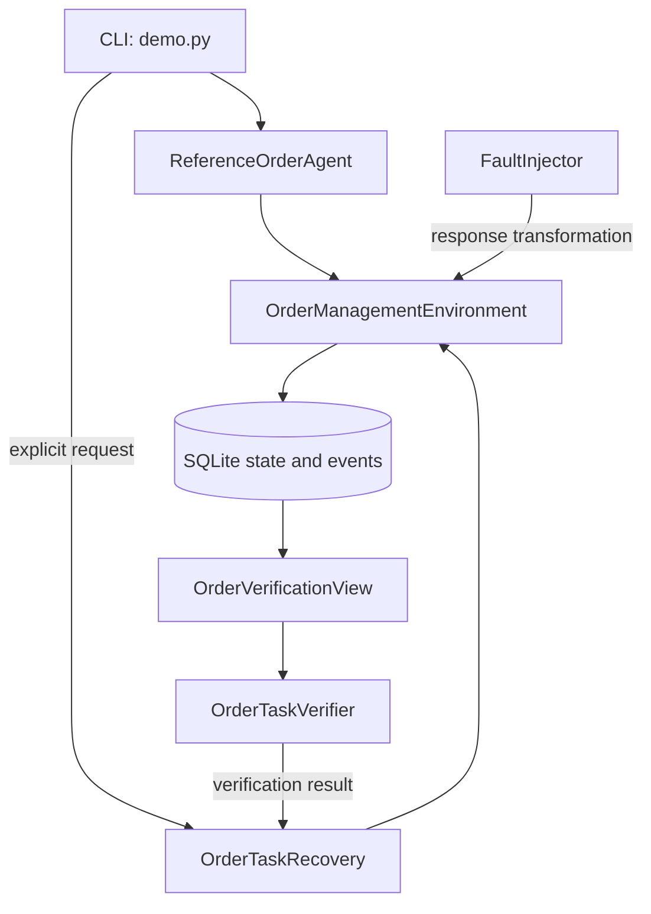

# IMMUNE: Early Failure Forecasting and Verified Recovery for Autonomous AI Agents

Phase I academic edition: evidence-grounded state verification and bounded REFRESH recovery.

## Academic Context

B.Tech Computer Science and Engineering, Department of Computer Science and Engineering, Vidya Academy of Science & Technology, APJ Abdul Kalam Technological University (KTU), 2019 Scheme. This repository presents the CSD415 S7 Project Phase I implementation, with continued development planned for S8.

The title preserves continuity with the original project proposal. The implemented Phase I scope is narrower: it focuses on independent state verification and bounded recovery. Operational early failure forecasting remains planned work and is not represented as an implemented capability. See the [implementation status](docs/implementation-status.md).

## Project Overview

IMMUNE demonstrates a reliability boundary between a deterministic order agent's execution and the correctness of its persisted result. An injected stale address response can make the agent complete normally while leaving an order linked to an outdated address. A separate read-only database interface verifies the task state. A requested, bounded REFRESH continuation re-reads the relevant information, attempts the update and verifies the resulting state.

The repository contains a local educational prototype. It uses synthetic customer and order records and requires no API credentials or model service.

## Problem Statement

Successful tool execution does not establish successful task completion. If an agent acts on stale observations, its workflow may complete without satisfying the intended state conditions. Recovery therefore requires explicit task predicates, independent state checks and a bounded continuation whose outcome is verified.

## Objectives

- Reproduce a deterministic order-address workflow and a stale-information failure.
- Verify persisted state independently of agent-visible tool responses.
- Permit a task-scoped REFRESH attempt only after failed verification.
- Record execution, injected faults, verification and recovery events.
- Provide an independently installable implementation and reproducible tests.

## Implemented Functionality

The reference agent retrieves customer C001, selects the unique current address in the returned data, reads order O001 and requests an address update. The fault injector can mark old address A001 as current in the first address response without changing the address table. The verifier checks persisted customer and order existence, a unique current address, address agreement, an allowed order status and exactly one actual address change.

REFRESH is explicitly requested through `--recover`. It requires FAIL, re-reads addresses and order, updates only when needed and verifies again. Repeated requests on the same controller instance reuse its result when the order hash is unchanged; intervening order changes prevent re-execution. See [system design](docs/architecture.md) for the exact admission and verification boundaries.

## Technical Foundations

IMMUNE applies established reliability principles within a small academic workflow:

- RIFL demonstrates how durable request identities and completion records can support linearizable retry behavior in distributed systems [1]. IMMUNE does not implement RIFL; the work explains why a client cannot infer an operation's effect from a missing response alone.
- Sagas formalize recovery for long-lived transactions as sequences of transactions with compensating actions [2]. IMMUNE implements only a task-specific REFRESH continuation and does not claim general transaction compensation.
- Runtime assurance research separates online monitoring, corrective planning and verification in autonomous systems [3]. IMMUNE adopts the separation between execution and independent verification but does not implement the paper's neural forecasting or safety guarantees.

These foundations are prior work. The academic contribution of this repository is their source-grounded application to a reproducible order-management demonstration, not a new reliability algorithm.

## System Architecture



Every implemented component is mapped to source in [architecture and system design](docs/architecture.md). Planned S8 work is documented separately in the [implementation status and roadmap](docs/implementation-status.md).

## Repository Structure

```text
README.md
pyproject.toml
requirements-lock.txt
docs/
|-- architecture.md
|-- implementation-status.md
`-- reproducibility.md
src/immune/
|-- demo.py
|-- agents/          # Reference agent and SQLite order environment
|-- core/            # Execution context and event types
|-- faults/          # Deterministic response fault injection
|-- models/          # Order-management domain models
|-- recovery/        # Bounded REFRESH recovery
|-- telemetry/       # Event storage and hashing
`-- verification/    # Independent persisted-state verification
tests/
|-- integration/
|-- scenarios/
`-- unit/
```

See the [architecture and system design](docs/architecture.md) and [implementation status and roadmap](docs/implementation-status.md) documents for component responsibilities and the Phase I/S8 boundary.

## Technology Stack

Python 3.12, SQLite through Python's `sqlite3`, SQLAlchemy Core 2.0.48, and pytest 9.0.2. Runtime code uses the Python standard library and SQLAlchemy; pytest is a test dependency. There is no web framework, LLM SDK, forecasting model or external database server in this edition.

## Installation and Configuration

Validated environment: Windows 11 x64, CPython 3.12.14 and PowerShell. Python 3.12 must be available as `python` in PATH, with the standard `venv`, `ensurepip` and `sqlite3` modules. Network access is required to obtain build and Python dependencies. Other operating systems and Python versions have not been validated.

From the repository root:

```powershell
python --version
python -m venv .venv
.\.venv\Scripts\python.exe -m pip install --disable-pip-version-check --no-cache-dir -c requirements-lock.txt ".[test]"
.\.venv\Scripts\python.exe -m pip check
```

`pyproject.toml` declares direct dependencies and the build backend. `requirements-lock.txt` constrains the dependency set validated on Windows Python 3.12. No environment file, database preparation or API key is required. Explicit interpreter paths avoid shell activation-policy changes.

## Execution and Demonstration

```powershell
.\.venv\Scripts\python.exe -m immune.demo healthy
.\.venv\Scripts\python.exe -m immune.demo stale-retrieval
.\.venv\Scripts\python.exe -m immune.demo stale-retrieval --recover --show-events
```

| Scenario | Agent execution | Independent verification | Result |
|---|---|---|---|
| Healthy | COMPLETED | PASS | Order uses A002 |
| Stale retrieval | COMPLETED | FAIL | Order remains at A001 |
| Stale retrieval with REFRESH | COMPLETED | FAIL, then PASS | Order changes to A002 |

Exit code 0 means the specified demonstration produced its expected verification outcome. The stale scenario intentionally expects FAIL. Unexpected outcomes return 1; invalid arguments return 2. Exit code 0 is therefore not a general task-success signal.

Each command creates a fresh temporary SQLite database, reads real persisted local state and removes that database on exit. `--show-events` prints the event sequence. The CLI does not retain durable session history. Logical timestamps are deterministic simulated time; they are not measured latency.

## Testing and Validation

```powershell
.\.venv\Scripts\python.exe -m pytest -q -p no:cacheprovider
```

The complete included suite covers healthy and faulty execution, verification, bounded recovery, refusal conditions, failed recovery tools, event integrity, hashing and read-only database behavior. The [reproducibility report](docs/reproducibility.md) records the exact environment, commands, exit codes, test totals and representative outputs. Passing tests establish only the behavior exercised by those tests.

## Presentation Traceability and Academic Evidence

The October 2026 [Project Phase I final-review presentation](docs/presentation-evidence-map.md) is supported by an explicit slide-to-source and slide-to-test evidence map. The source contains the **deterministic Phase I implementation only**; literature precedents and proposed Phase II integrations are distinguished from executable functionality.

- [Presentation-to-implementation traceability](docs/presentation-evidence-map.md): key claims, their source and test evidence, and implementation boundaries.
- [Scholarly foundations](docs/scholarly-foundations.md): ten cited research publications, publication status, technical relevance, and non-adoption caveats.
- [SDG alignment and evidence limitations](docs/sdg-alignment.md): qualitative mapping to SDGs 9, 8, and 4 without unsupported impact claims.
- [Continuous validation workflow](.github/workflows/phase-i-validation.yml): Windows Python 3.12 tests, static checks and demonstration outcomes, subject to GitHub Actions being enabled by the repository owner.
- [Software citation metadata](CITATION.cff): machine-readable citation for the institutional academic edition, not a research-publication DOI.

The final presentation's supporting-source entry [S1] identifies commit `79d6ade89d1908d9af6bc87b4e785578061b110a`, the **frozen original Phase I implementation snapshot**. These subsequent documentation and validation additions do not change its executable source. If the institution requires the presentation to cite the latest documentation commit, update the supporting-source reference explicitly rather than silently rewriting historical evidence.

## Static Analysis and Formatting

Ruff 0.17.2 was used for lint rules `E4`, `E7`, `E9`, `F` and `I`, together with a formatting check, consistent with the [reproducibility report](docs/reproducibility.md). From the repository root, after completing the installation above, run:

```powershell
.\.venv\Scripts\python.exe -m pip install --disable-pip-version-check "ruff==0.17.2"
.\.venv\Scripts\python.exe -m ruff check --select E4,E7,E9,F,I src tests
.\.venv\Scripts\python.exe -m ruff format --check src tests
```

Both checks are non-mutating. Ruff is an optional development validation tool and is not a runtime dependency.

## Limitations

- The agent is deterministic; no real LLM controls execution or recovery.
- Operational early failure forecasting, calibrated runtime confidence and automatic fault localization are not implemented.
- The verifier is fixed to C001 and O001 and trusts the local schema and database. Its reads are not one atomic cross-table snapshot.
- The recovery bound is per controller instance in one process. It is not a persistent global admission service, universal enforcement layer or arbitrary rollback mechanism.
- Recovery checks use supplied verification results; they are not cryptographically bound to invocation arguments or fresh state. Concurrent changes outside the tested order-hash checks require further work.
- The web and MCP demonstrations are excluded. No dashboard, network service or production deployment is provided.

## Future Work

S8 work will prioritize configured workflows, task-bound verification, persistent recovery budgets and session evidence, additional controlled faults, and invocation-correct integration. Any future LLM integration or forecasting capability will require its own implementation and evaluation before being described as delivered. See the [Phase II roadmap](docs/implementation-status.md).

## SDG 9 Alignment

As a qualitative academic interpretation, repeatable fault testing and auditable recovery can support engineering practices for dependable digital infrastructure and technological capability. This relates to the infrastructure and innovation themes of [United Nations SDG 9](https://sdgs.un.org/goals/goal9). No SDG indicator, infrastructure deployment or societal impact has been measured.

## Project Team and Supervision

Team members: Adhil Naseem, Nithin C, Sath Sree Hari K. Project guide: Neethu George.

## References

- [1] C. Lee, S. J. Park, A. Kejriwal, S. Matsushita, and J. K. Ousterhout, “Implementing Linearizability at Large Scale and Low Latency,” *Proceedings of the 25th ACM Symposium on Operating Systems Principles*, pp. 71–86, 2015. [doi:10.1145/2815400.2815416](https://doi.org/10.1145/2815400.2815416).
- [2] H. Garcia-Molina and K. Salem, “Sagas,” *Proceedings of the 1987 ACM SIGMOD International Conference on Management of Data*, pp. 249–259, 1987. [doi:10.1145/38713.38742](https://doi.org/10.1145/38713.38742).
- [3] E. Yel et al., “Assured Runtime Monitoring and Planning: Toward Verification of Neural Networks for Safe Autonomous Operations,” *IEEE Robotics & Automation Magazine*, vol. 27, no. 2, pp. 102–116, 2020. [doi:10.1109/MRA.2020.2981114](https://doi.org/10.1109/MRA.2020.2981114).
- [Python 3.12 documentation](https://docs.python.org/3.12/).
- [SQLite URI filenames and read-only mode](https://www.sqlite.org/uri.html).
- [SQLAlchemy 2.0 connections and transactions](https://docs.sqlalchemy.org/en/20/core/connections.html).
- [United Nations Sustainable Development Goal 9](https://sdgs.un.org/goals/goal9).

No project license is included. Public availability alone does not grant permission to copy, modify or redistribute the project source.
