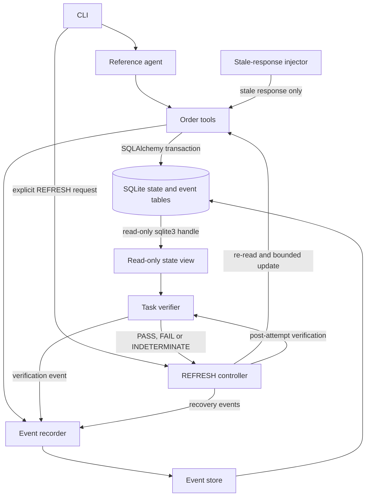
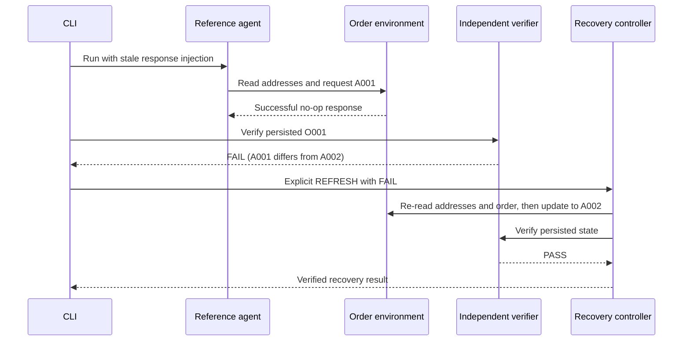
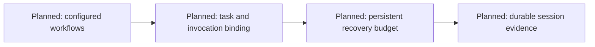

# System Architecture and System Design

## Project Overview

The integrated execution path is the deterministic order workflow. Agent-observed responses, persisted domain state, independent verification and recovery decisions have distinct roles. There is no connection to a model provider or a forecasting component.

## System Architecture

SQLite domain state, update history, events and run metadata occupy one file. The diagram's database represents that shared file; the view bypasses fault-transformed tool responses. A separate connection establishes a read-only interface, not a separate trust domain or independent source of business truth.

| Component | Source | Major interface |
|---|---|---|
| Command orchestration | `src/immune/demo.py` | `main(argv)` |
| Deterministic agent | `src/immune/agents/reference_order_agent.py` | `ReferenceOrderAgent.run()` |
| Tools and state schema | `src/immune/agents/order_lab.py` | `get_customer`, `get_addresses`, `get_order`, `update_order_shipping_address` |
| Domain objects | `src/immune/models/order_lab.py` | `Customer`, `Address`, `Order`, `OrderStatus` |
| Fault injection | `src/immune/faults/injector.py`, `specifications.py` | `intercept`, `FaultSpecification` |
| Independent state view | `src/immune/agents/order_lab.py` | `OrderVerificationView` read methods |
| Task verifier | `src/immune/verification/order_task.py` | `verify() -> VerificationResult` |
| Recovery | `src/immune/recovery/order_task.py`, `interfaces.py` | `recover(RecoveryRequest) -> RecoveryResult` |
| Events and identity | `src/immune/core/` | immutable event and execution/run context types |
| Event persistence | `src/immune/telemetry/event_store.py`, `lab_events.py` | append, transaction, events-for-run, logical clock |
| Connection policy and hashing | `src/immune/telemetry/sqlite_config.py`, `hashing.py` | read-only URI, foreign keys, JSON SHA-256 |

## System Design

### Domain and storage

`customers` identifies C001. `addresses` contains A001 (old) and A002 (current). `orders` initially links O001 to A001 with CONFIRMED status and version 1. `order_update_history` records actual address changes. `execution_events` stores structured execution evidence and `run_metadata` binds run identity. The schema is created locally at the beginning of each scenario.

The address update validates order and address existence, customer ownership and DRAFT/CONFIRMED status. A real change increments the order version and appends update history. A same-address request is a no-op. Mutation, history and its canonical result event use one transaction; the earlier tool-call event is separate. An event-write failure inside that transaction rolls back the change. No notification-dispatch table or tool is included.

### Agent-visible and persisted state

The agent selects an address using the returned `Address.is_current` values. The fault injector transforms only the targeted successful response, once, using the recorded operation occurrence. It marks A001 current in the returned list. It does not change the persisted current-address designation. The deliberately visible debug marker identifies an injected fault; it is not a predicted diagnosis.

### Verification boundary

The verifier reads C001, O001, current-address flags and update count through a separate SQLite URI opened with `mode=ro` and `PRAGMA query_only=ON`. It checks six predicates: order existence, customer existence, a unique current address, address agreement, permitted status and exactly one real address update.

Any false predicate yields FAIL. If no predicate is false but a required result is unavailable, the verdict is INDETERMINATE. Otherwise it is PASS. Known verification read errors produce INDETERMINATE; unexpected programming exceptions propagate. The verifier records checks and a state hash. It does not infer success from the agent's completion event.

These predicates do not prove every business invariant. The verifier does not cover arbitrary customers, collateral external effects or concurrent global consistency. Its individual reads do not share one explicit snapshot transaction. The local database and schema are trusted.

### Recovery conditions

1. Reject an unsupported action, mismatched run or a task other than C001/O001.
2. CONTINUE performs no recovery action. PASS needs no recovery; missing or INDETERMINATE verification is refused.
3. A supplied FAIL permits one REFRESH attempt on the controller instance.
4. Re-read addresses and select exactly one current result. Re-read the order and request a change only if necessary.
5. Independently verify persisted state after the attempt. Success is assigned only for PASS.
6. Record recovery completion, hashes and order version. Reusing the recovery identifier returns the cached result if the order hash is unchanged. A different identifier or changed order prevents another attempt on that instance.

The budget and cached result are in-memory. Reconstructing the controller resets that budget. Requests and verification are not authenticated or comprehensively bound to a task snapshot; hashes do not establish authenticity. The CLI supplies the result from its own preceding verifier call. General recovery-admission/firewall components are excluded because they are unnecessary to this integrated path.

### Demonstration sequence

## Future Work

This diagram describes proposed Phase II work only. It is separate from the executable architecture. Real LLM integration and any forecasting capability remain conditional development goals.

## References

[SQLite read-only URI semantics](https://www.sqlite.org/uri.html) and [SQLAlchemy transaction interfaces](https://docs.sqlalchemy.org/en/20/core/connections.html) describe the underlying mechanisms. The implementation's narrower guarantees are stated above.

